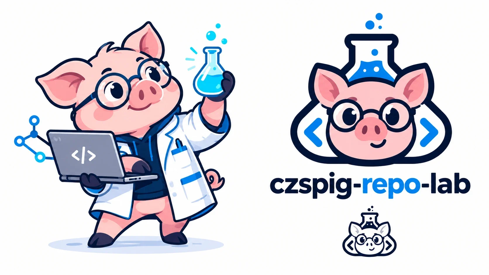

# czspig-repo-lab · 猪猪 Repo 研究所



把开源仓库拆到源码那一层：挑选值得研究的开源项目，从目录结构、核心链路到运行方式逐层拆解，每份报告都附带能在本地跑起来的最小实验。

在线访问：<https://czspig.github.io/czspig-repo-lab/>

## 目录结构

```
czspig-repo-lab/
├── index.html          # 首页：研究台账、技术栈雷达、研究方法、实验日志
├── assets/
│   ├── data.js         # 站点数据：REPORTS（报告列表）、LOG（实验日志）、STACKS（技术栈雷达）
│   ├── app.js          # 页面逻辑：主题切换、搜索 / 标签筛选、卡片 / 列表视图
│   ├── styles.css      # 样式（明暗两套配色）
│   └── *.webp / *.png  # 封面、吉祥物、Logo
└── reports/            # 各开源项目的解析报告（每篇一个独立 HTML，后续添加）
```

纯静态页面，不需要构建。

## 新增一份解析报告

1. 把报告页放到 `reports/<slug>.html`
2. 在 `assets/data.js` 的 `REPORTS` 里追加一条（字段说明见文件顶部注释）
3. 在 `LOG` 里记一笔更新

## 本地预览

```bash
python -m http.server 4500
```

然后打开 <http://localhost:4500/>。

## 部署

GitHub Pages：仓库 Settings → Pages 选择 `Deploy from a branch`，分支 `main`，目录 `/ (root)`。

技术栈图标来自 [Simple Icons](https://simpleicons.org/)（CC0）。
